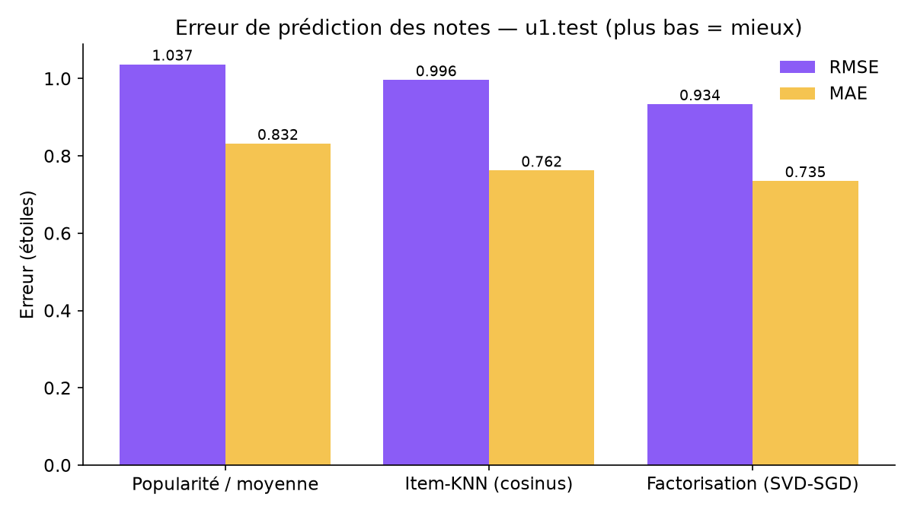
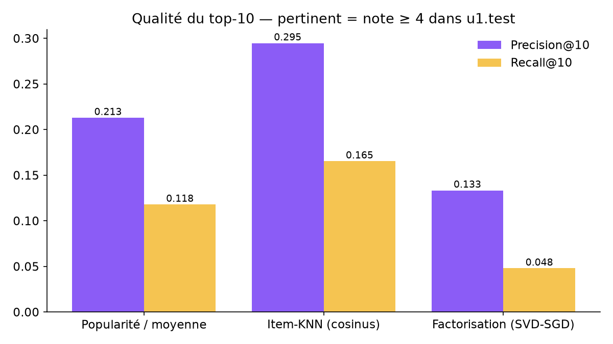
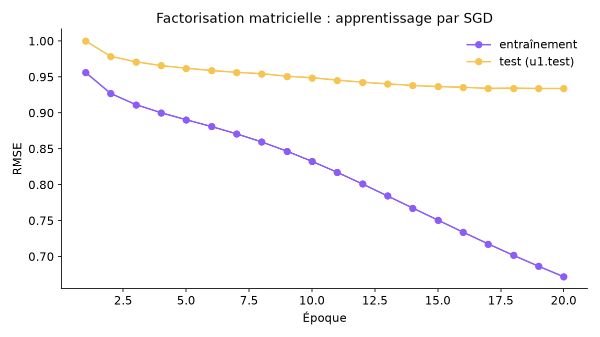

# 🎬 Recommandation de films — MovieLens 100K

[](https://github.com/bienvenuessegnon/movielens-recommender/actions/workflows/tests.yml)


Un système de recommandation construit **from scratch** (numpy / pandas, sans
bibliothèque de recommandation) sur les 100 000 notes de MovieLens 100K.
Suite logique de mes vidéos **#30JoursDeCode** : après l'exploration des
données, on passe aux modèles.

> **English summary** — A from-scratch movie recommender on MovieLens 100K:
> a popularity/mean baseline, item-based collaborative filtering (adjusted
> cosine) and biased matrix factorization trained with SGD, evaluated on the
> official `u1.base/u1.test` split with RMSE, MAE, Precision@10 and Recall@10.
> Results below come from real runs (`python -m src.evaluate`).

## Résultats

Découpage officiel GroupLens **u1.base (80 000 notes) / u1.test (20 000 notes)**.
Top-N : un film est *pertinent* s'il est noté ≥ 4 dans le test ; les films déjà
vus à l'entraînement sont exclus ; moyenne sur les 456 utilisateurs du test
ayant au moins un film pertinent.

| Modèle | RMSE ↓ | MAE ↓ | Precision@10 ↑ | Recall@10 ↑ |
| --- | --- | --- | --- | --- |
| Popularité / moyenne | 1.0370 | 0.8319 | 0.2129 | 0.1179 |
| Item-KNN (cosinus ajusté, k = 40) | 0.9963 | 0.7622 | **0.2947** | **0.1654** |
| Factorisation matricielle (SVD-SGD, 50 facteurs) | **0.9339** | **0.7353** | 0.1333 | 0.0479 |

<p align="center">
  
  
</p>
<p align="center">
  
</p>

**Ce que montrent ces chiffres**

- La **factorisation matricielle** prédit le mieux les notes (RMSE 0,934).
- **Item-KNN** donne le meilleur top-10 : prédire une note et classer des films
  sont deux objectifs différents.
- Classer par note prédite favorise des films peu vus à forte moyenne estimée,
  d'où la faible Precision@10 de la factorisation. La **popularité** reste une
  référence étonnamment solide pour le top-N.
- La courbe d'apprentissage montre un début de sur-apprentissage (l'erreur
  d'entraînement continue de baisser, celle du test se stabilise).

Tableaux complets : [`results/metrics.md`](results/metrics.md),
[`results/metrics.csv`](results/metrics.csv) (le temps d'entraînement qui y figure
dépend de la machine).

## Les modèles

| Modèle | Prédiction de note | Top-N |
| --- | --- | --- |
| `PopularityBaseline` | moyenne du film lissée vers la moyenne globale | films les plus notés |
| `ItemKNN` | moyenne de l'utilisateur + écarts pondérés des 40 films les plus similaires (cosinus sur notes centrées, pénalité des co-notations rares) | somme des similarités avec les films vus |
| `MatrixFactorization` | r̂ = μ + b_u + b_i + p_u·q_i, SGD avec régularisation L2 | note prédite |

Code : [`src/models.py`](src/models.py) · métriques : [`src/metrics.py`](src/metrics.py).

## Démarrage rapide

```bash
git clone https://github.com/bienvenuessegnon/movielens-recommender.git
cd movielens-recommender
python -m venv .venv && source .venv/bin/activate   # Windows : .venv\Scripts\activate
pip install -r requirements.txt

python -m src.data                          # télécharge MovieLens 100K dans data/
python -m src.evaluate                      # entraîne, évalue, régénère results/ (~15 s)
python -m src.recommend --user 1 --k 10     # top-10 pour l'utilisateur 1
python -m src.recommend --user 1 --k 10 --model svd
python -m pytest -q                         # tests rapides (données synthétiques)
python scripts/build_notebooks.py           # régénère et exécute les notebooks
```

Exemple réel (`python -m src.recommend --user 1 --k 5`, Item-KNN entraîné sur les 100 000 notes) :

```
 rang  item_id                                                                       titre
    1      357                                      One Flew Over the Cuckoo's Nest (1975)
    2      318                                                     Schindler's List (1993)
    3      651                                                                Glory (1989)
    4      483                                                           Casablanca (1942)
    5      408                                                       Close Shave, A (1995)
```

Depuis Python :

```python
from src.recommend import recommend
recommend(user_id=1, k=10, model="itemknn")   # DataFrame rang / item_id / titre
```

## Structure

```
├── data/                    # vide : python -m src.data télécharge ml-100k (ignoré par git)
├── notebooks/
│   ├── 01_exploration.ipynb # EDA : distribution des notes, genres, longue traîne
│   └── 02_modeles.ipynb     # entraînement, comparaison, exemples de recommandations
├── results/                 # métriques (CSV + Markdown) et graphiques, issus de src.evaluate
├── scripts/build_notebooks.py
├── src/
│   ├── data.py              # téléchargement vérifié, chargement, découpages
│   ├── models.py            # popularité, Item-KNN, factorisation matricielle
│   ├── metrics.py           # RMSE, MAE, Precision@k, Recall@k
│   ├── evaluate.py          # pipeline d'évaluation → results/
│   └── recommend.py         # recommend(user_id, k) + CLI
├── tests/                   # pytest
└── .github/workflows/tests.yml
```

## Limites et pistes

- Une seule partition (u1) : une validation croisée sur u1–u5 donnerait des
  intervalles plus fiables.
- Hyperparamètres choisis à la main, sans recherche systématique.
- Données historiques (1997–1998), notes explicites uniquement : pas de
  démarrage à froid pour un nouvel utilisateur au-delà de la popularité.
- Pistes : ALS implicite ou BPR pour optimiser directement le classement,
  diversité/nouveauté des recommandations, modèle hybride avec les genres.

## Données et conditions d'utilisation

Données : **MovieLens 100K**, GroupLens Research, University of Minnesota —
<https://grouplens.org/datasets/movielens/100k/>. 943 utilisateurs, 1 682 films,
100 000 notes de 1 à 5, collectées entre septembre 1997 et avril 1998.

Le jeu de données **n'est pas inclus** dans ce dépôt. Selon les conditions de
GroupLens, il peut être utilisé à des fins de recherche ; il ne doit pas être
redistribué sans autorisation, ni utilisé à des fins commerciales sans
permission ; aucune approbation de l'Université du Minnesota ou de GroupLens ne
doit être suggérée ; toute publication doit citer :

> F. Maxwell Harper and Joseph A. Konstan. 2015. *The MovieLens Datasets:
> History and Context.* ACM Transactions on Interactive Intelligent Systems
> (TiiS) 5, 4, Article 19. <https://doi.org/10.1145/2827872>

## Auteur

**Bienvenu ESSEGNON** — AI Engineer Aspiring & Mathematicien ·
GitHub [@bienvenuessegnon](https://github.com/bienvenuessegnon)

Code sous licence [MIT](LICENSE).
